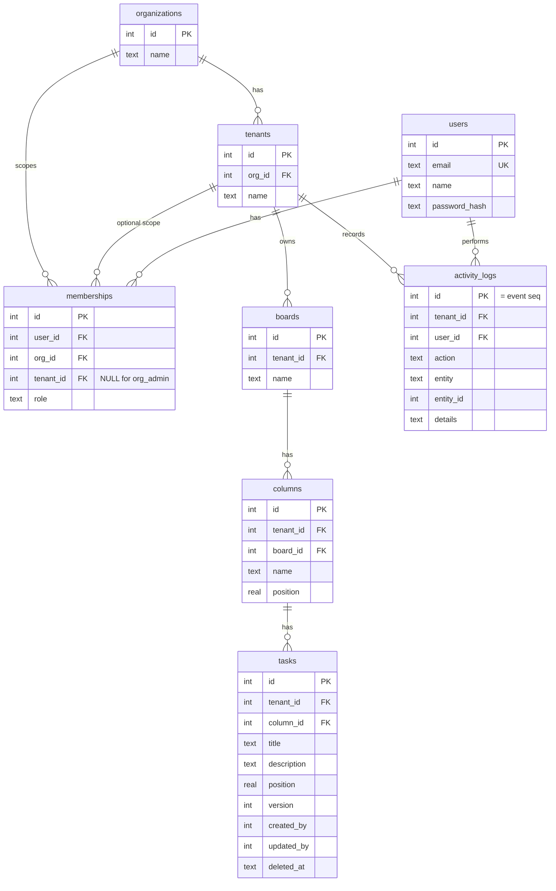

# Database schema (ER diagram)

Isolation is enforced in the schema, not only in code:

* `boards`, `columns`, `tasks`, `activity_logs` all carry `tenant_id`.
* Children reference parents by a **composite FK** `(parent_id, tenant_id)` -> `parent(id, tenant_id)`, so a task can never point to a column of another tenant.
* `memberships (tenant_id, org_id)` -> `tenants (id, org_id)` guarantees a tenant membership belongs to the tenant's own organization.
* `CHECK ((role='org_admin') = (tenant_id IS NULL))` keeps org-level and tenant-level roles unambiguous.
* Indexes are tenant-leading: `(tenant_id, column_id, position)`, `(tenant_id, id)`.
